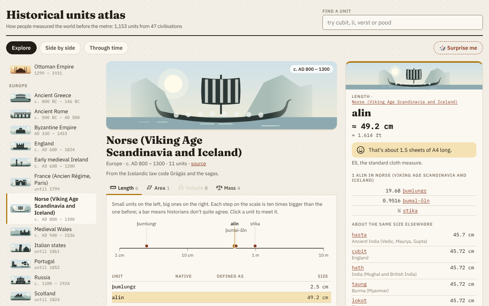
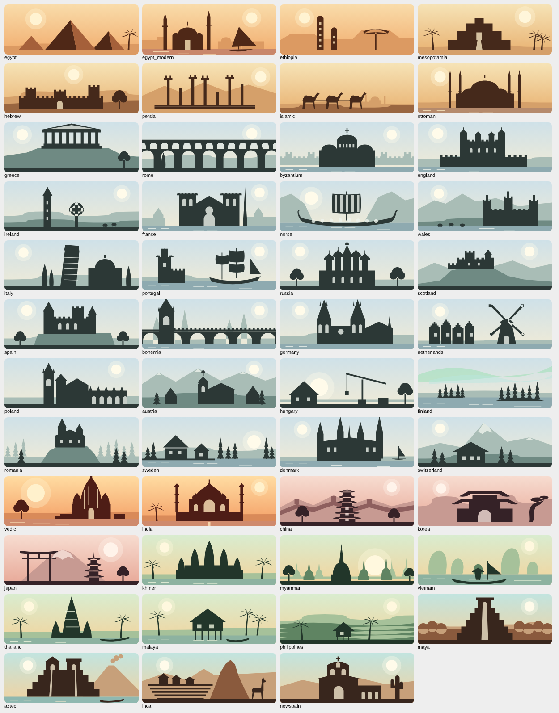

<p align="center"></p>

<h1 align="center">Historical units atlas</h1>

<p align="center">How people measured the world before the metre: 1,853 units of length, area,
volume and weight from 78 civilisations, from ancient Egypt to the Inca and 19th-century Argentina.</p>



## Using it

- **Web:** open `index.html` (one self-contained file), or publish it with GitHub Pages.
- **Android:** install `HistoricalUnits.apk` from the [releases](../../releases). Works offline, in portrait on a phone and in landscape on a tablet.

## What's in it

- **Explore** one civilisation: its units on a scale, with the original name and script, the definition ("1⁄16 pes") and the size.
- **Side by side:** every civilisation as a row, so you can see what everybody else used for about the same length, area, volume or weight.
- **Through time:** when each system was in use, with the metre (1799) marked.
- A card per unit with an everyday comparison ("about as long as a sheet of A4 paper"), the closest units elsewhere, and how the value changed over time or by city where that is known.
- A landscape for every civilisation, all drawn in the same style (`src/scenes.js`).



## Data

Each file in `data/` is one civilisation:

```
@ id | name | region | source | period
# notes about the system
quantity | name | native name | definition | value | notes
```

A definition is "N unit", "N square unit" or "N cubic unit" of the same file; a value is metric ("52.3 cm", "0.296–0.333 m").
A notes field starting with `@` gives an earlier or regional value of the unit above it. `tools/build_data.py` works out the missing
values from the definitions and reports where a stated value and its definition disagree; the page shows those cases.

Most values come from the Wikipedia article on each system; the Maya units from O'Brien & Christiansen (1986), the Norse ones from
Viking Answer Lady. Ancient values are estimates, and the atlas shows ranges where sources differ.

## Building

```sh
python3 build.py        # build/data.json, index.html and android/assets/index.html
android/build.sh        # android/HistoricalUnits.apk (JDK, Android SDK platform 23, aapt, dx, zipalign, apksigner; no Gradle)
```

The bundled fonts for the app are made with `tools/fonts.py` from Fontsource packages (`npm pack @fontsource/fraunces` etc.).

## Licenses

Code MIT, data CC BY-SA 4.0 (following Wikipedia), fonts SIL OFL 1.1. See [LICENSE](LICENSE).
